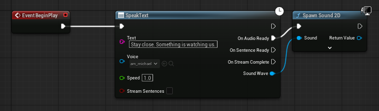
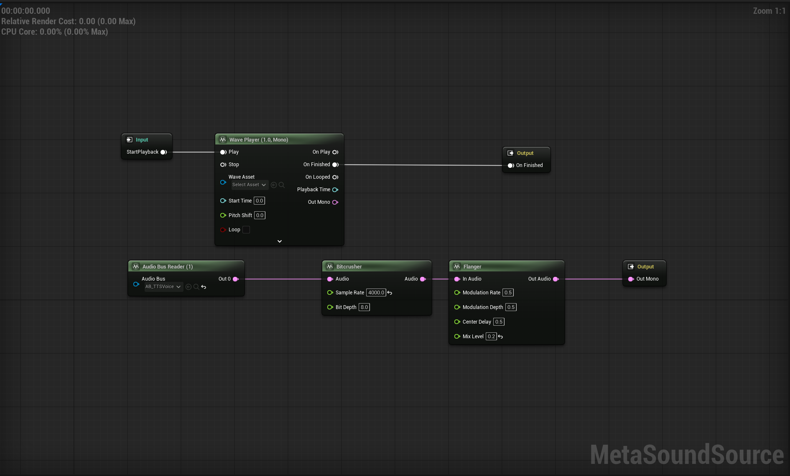

SynthVox turns text into natural speech on the player's machine. It needs no internet connection, accounts, API keys
or per-character fees. It ships with 48 voices in 6 languages and integrates with Blueprints, C++ and MetaSound.

Version 1.0 · Unreal Engine 5.8 · Windows, Linux, macOS (desktop)
Support: mandasartur@gmail.com

---

## Contents

1. [Quick start](#quick-start)
2. [Voices and languages](#voices-and-languages)
3. [Blueprint nodes](#blueprint-nodes)
4. [Streaming, sentence events and cancel](#streaming-sentence-events-and-cancel)
5. [Voice blending](#voice-blending)
6. [MetaSound processing (Audio Bus)](#metasound-processing-audio-bus)
7. [C++ API](#c-api)
8. [Project Settings](#project-settings)
9. [Writing text for each language](#writing-text-for-each-language)
10. [Performance and packaging](#performance-and-packaging)
11. [Troubleshooting](#troubleshooting)
12. [Licensing](#licensing)

---

## Quick start

1. Enable **SynthVox - Offline Neural TTS** in *Edit > Plugins* and restart the editor. Its dependency
   `NNERuntimeORT` (ships with Unreal) is enabled automatically.
2. Open the demo: *Content Browser > Plugins > SynthVox - Offline Neural TTS Content > Demo > DemoLevel*, press Play,
   pick a voice, type a line in that voice's language and press **Speak**.
3. In your own Blueprint:
   - Add **Speak Text** (category *Offline Neural TTS*), set **Text** and pick a **Voice** asset
     (`/OfflineNeuralTTS/Voices/…`, e.g. `af_heart`).
   - From **On Audio Ready**, call **Spawn Sound 2D** (or *Spawn Sound at Location* / an Audio Component) with the
     **Sound Wave** pin.

That's it: synthesis runs on a background thread and the result arrives on the game thread.

A ready-made copy of this graph is `Demo/BP_SynthVoxExample`: drag it into a level and press Play.



> Check **Is Offline TTS Ready** before the first call if you speak during the very first frame; the models load
> asynchronously at startup (typically under a second).

---

## Voices and languages

Every voice is a `UTTSVoiceAsset` Data Asset in `/OfflineNeuralTTS/Voices`. The voice decides the language: send it
text in that language.

| Language | Voices (asset name, F = female, M = male) |
| --- | --- |
| English (US) | `af_heart` (F), `af_bella` (F), `af_alloy` (F), `af_aoede` (F), `af_jessica` (F), `af_kore` (F), `af_nicole` (F), `af_nova` (F), `af_river` (F), `af_sarah` (F), `af_sky` (F), `af` (F, default), `am_michael` (M), `am_adam` (M), `am_echo` (M), `am_eric` (M), `am_fenrir` (M), `am_liam` (M), `am_onyx` (M), `am_puck` (M), `am_santa` (M) |
| English (UK) | `bf_emma` (F), `bf_alice` (F), `bf_isabella` (F), `bf_lily` (F), `bm_george` (M), `bm_daniel` (M), `bm_fable` (M), `bm_lewis` (M) |
| Mandarin Chinese | `zf_xiaoxiao` (F), `zf_xiaobei` (F), `zf_xiaoni` (F), `zf_xiaoyi` (F), `zm_yunxi` (M), `zm_yunjian` (M), `zm_yunxia` (M), `zm_yunyang` (M) |
| Hindi | `hf_alpha` (F), `hf_beta` (F), `hm_omega` (M), `hm_psi` (M) |
| Spanish (Spain) | `ef_dora` (F), `em_alex` (M), `em_santa` (M) |
| French | `ff_siwis` (F), `fm_lucien` (M) |
| Greek | `gf_eleni` (F), `gm_nikos` (M) |

Every bundled voice runs on **Kokoro-82M** (24 kHz). The plugin also supports **Piper** (VITS, 22.05 kHz) voice models
behind the same API; you never pick an engine yourself, the voice asset decides.

Every bundled voice was checked by transcribing its audio back with speech recognition.

---

## Blueprint nodes

| Node | What it does |
| --- | --- |
| **Speak Text** (async) | Synthesizes `Text` with `Voice` at `Speed` (1.0 = normal). Pins: **On Audio Ready** (Sound Wave), **On Sentence Ready**, **On Stream Complete**. Tick **Stream Sentences** for streaming. |
| **Speak Text Blended** (async) | Same, but with a weighted list of voices (see [Voice blending](#voice-blending)). |
| **Is Offline TTS Ready** | True once the models are loaded. |
| **Stream Speech To Audio Bus** | Pushes a spoken Sound Wave into an Audio Bus for MetaSound processing. |
| **Cancel Speech Audio Bus** | Stops speech still feeding a given Audio Bus. |
| **Cancel Speech** (Offline TTS subsystem) | Stops any streaming synthesis in progress. |

The returned Sound Wave is a regular `USoundWave` (procedural): play it with any audio node, attach it to an Audio
Component, apply attenuation, concurrency and submixes as usual.

---

## Streaming, sentence events and cancel

With **Stream Sentences** ticked, the text is split into sentences and playback starts as soon as the first one is
ready; the rest are appended while it plays. Long monologues start in roughly the time of one sentence instead of the
whole passage.

- **On Sentence Ready** fires per sentence with its index, start time and duration in the clip: use it for subtitles,
  lip-sync cues or camera cuts.
- **On Stream Complete** fires after the last sentence (also after a cancel).
- **Cancel Speech** stops further sentences. Starting a new streaming call cancels the previous one automatically.

Sentence ends are `.` `!` `?`, the Chinese `。！？` and the Hindi danda `।`. Abbreviations like "Mr." and decimals
like "3.14" don't split.

---

## Voice blending

**Speak Text Blended** takes an array of `TTS Voice Blend Entry` (Voice + Weight). Weights are relative:
`af_heart 0.7` + `am_michael 0.3` gives a voice between the two, closer to Heart. Use it to give each NPC a unique
voice from the bundled set.

- Blend voices of the **same language** for best results.

---

## MetaSound processing (Audio Bus)

Runtime-generated Sound Waves can't be fed into a MetaSound **Wave Player** (it only reads imported, cooked audio).
SynthVox routes speech through an **Audio Bus** instead:

1. Create an **Audio Bus** asset (e.g. `AB_Voice`).
2. In your MetaSound Source, add an **Audio Bus Reader** pointing at `AB_Voice`, process it (filters, bit crush,
   reverb, pitch…), and send it to the output.
3. When speech is ready: **Spawn Sound 2D** (or play) your MetaSound, then **Stream Speech To Audio Bus**
   (`AB_Voice`, Sound Wave).

The Audio Bus path takes the finished line: use **Speak Text** without **Stream Sentences**, then push the result.
Streaming and the Audio Bus path don't combine in this version.

Resampling from the voice's rate (24 or 22.05 kHz) to the mixer rate is automatic. **Cancel Speech Audio Bus** cuts
speech still buffered on a bus. A complete example: `Demo/BP_TTSMetaSoundDemo` + `Demo/MSS_TTSPostProcess` (radio
effect), also reachable from the demo UI via **Process via MetaSound**.



---

## C++ API

Add `"OfflineNeuralTTS"` to your module's dependencies, then use the game-instance subsystem:

```cpp
#include "TTSSubsystem.h"
#include "TTSVoiceAsset.h"
#include "Kismet/GameplayStatics.h"

UTTSSubsystem* TTS = GetGameInstance()->GetSubsystem<UTTSSubsystem>();
UTTSVoiceAsset* Voice = LoadObject<UTTSVoiceAsset>(nullptr, TEXT("/OfflineNeuralTTS/Voices/am_michael.am_michael"));
if (TTS && TTS->IsReady() && Voice)
{
    TTS->SpeakText(TEXT("Stay close. Something is watching us."), Voice, 1.0f,
        [this](USoundWaveProcedural* Wave) { if (Wave) { UGameplayStatics::SpawnSound2D(this, Wave); } });
}
```

Also available: `SpeakTextStreaming` (with per-sentence and completion callbacks), `SpeakTextBlended`,
`SpeakTextStreamingBlended` and `CancelSpeech`.

---

## Project Settings

*Project Settings > Plugins > Offline Neural TTS*:

| Setting | Default | Notes |
| --- | --- | --- |
| Acoustic Model | `Kokoro82M` | Kokoro-82M ONNX model asset. |
| Lexicon US / GB / ZH | bundled | Pronunciation dictionaries. |
| Neural G2P Model | `G2PEnUS` | Neural fallback for English words missing from the dictionary. |
| Use Neural G2P Fallback | on | Neural pronunciation for English words missing from the dictionary; off falls back to spelling rules. |
| Runtime Name | `NNERuntimeORTCpu` | NNE runtime used for inference. |

---

## Writing text for each language

- Write in the language's own script: Hanzi for Mandarin, Devanagari for Hindi, Greek letters with accents (tonos)
  for Greek. Greek stress comes from the accent marks: ALL-CAPS Greek without accents loses it.
- Numbers, decimals and percentages are read in each language (`3,5 %`, `1.500`, `२०२६`).
- English: acronyms are spelled (`NPC`), heteronyms follow context
  (*I **read** it yesterday* vs *I will **read** it*).
- Text in one language sent to a voice of another produces poor or no audio (the demo tells you which language the
  selected voice speaks).
- Displaying Hindi in your own UI needs a font with Devanagari glyphs (the engine default has none). The demo uses
  `Demo/Fonts/F_DemoText` (Roboto + Noto Sans Devanagari); feel free to reuse it.

---

## Performance and packaging

- Inference runs on the CPU through Unreal NNE, off the game thread. On the development PC (16-core desktop CPU) a
  4.3 s line synthesized in about 2.9 s. Measure on your minimum-spec hardware, and use **Stream Sentences** for long
  text so playback starts after the first sentence.
- Content size: about 410 MB (Kokoro model ~325 MB, English G2P ~61 MB, voices and dictionaries). Unused voice assets
  can be deleted from your project's copy.
- Packaged builds need nothing extra: models and voices are regular assets, cooked with your game. No network access
  happens at any point.
- Voices you pick on a node or property are cooked automatically. If you load voices by path at runtime instead
  (e.g. `LoadObject` on `/OfflineNeuralTTS/Voices/...`), add that folder to *Project Settings > Packaging >
  Additional Asset Directories to Cook*, or the packaged game reports that it can't load the voice.

---

## Troubleshooting

| Symptom | Fix |
| --- | --- |
| No sound at all | Check that **On Audio Ready** fires (log category `LogOfflineNeuralTTS`). If it does, check Windows' Volume Mixer for "Unreal Editor" (per-app volume can be 0), and that the game window has focus (Unreal mutes unfocused windows by default: `[Audio] UnfocusedVolumeMultiplier`). |
| "produced no phonemes" / synthesis failed | The text doesn't match the voice's language, or contains no letters. |
| Hindi shows boxes in your UI | Use a font with Devanagari (see above). |
| Speech plays twice as fast through MetaSound | Use **Stream Speech To Audio Bus** (it resamples); don't push raw PCM yourself. |
| First call is silent | Wait for **Is Offline TTS Ready**. |

Logs: `LogOfflineNeuralTTS` reports every synthesis with its duration and peak level.

---

## Licensing

SynthVox's code is covered by the Fab license. Bundled models and data use permissive licenses; full texts are in
[`ThirdPartyNotices.txt`](third-party-notices.html):

- Kokoro-82M (model and voices): Apache 2.0
- misaki lexicons, jieba / pypinyin / pinyin-to-ipa data, DeepPhonemizer: MIT
- Noto Sans Devanagari (demo font): SIL Open Font License 1.1

No espeak-ng or other GPL/LGPL code is included: every language's pronunciation is SynthVox's own code.

Support: mandasartur@gmail.com
